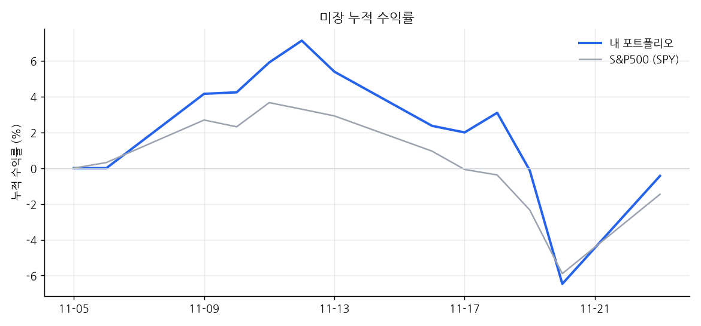
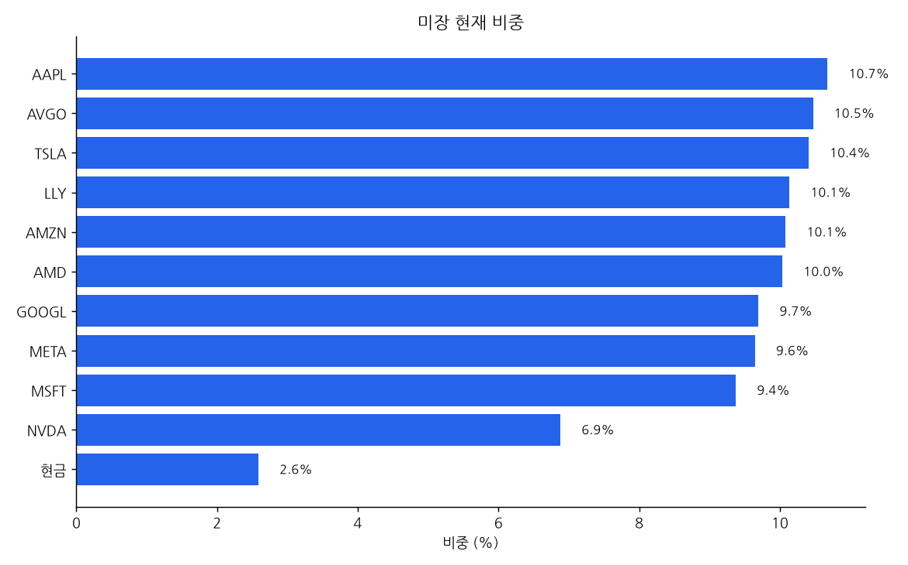
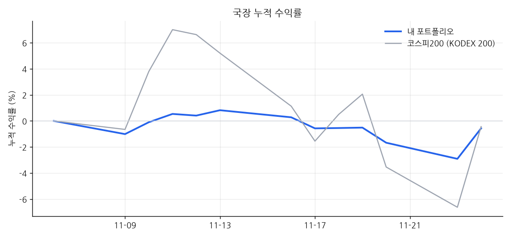
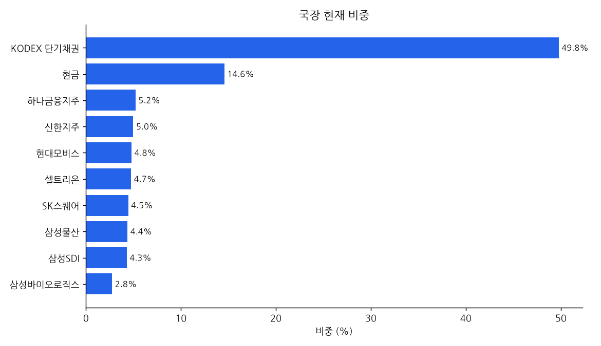

# 📈 내 자동매매 포트폴리오

_마지막 갱신: 2026-11-27 16:00 (KST) · 라즈베리파이 자동 업데이트_

| 트랙 | 시작일 | 누적 수익률 | 비교 지수 | 초과 | 최근 1개월 | 국면 |
|---|---|---|---|---|---|---|
| 미장 | 2026-11-05 | **-3.04%** | -2.22% | -0.82% | - | BEAR |
| 국장 | 2026-11-06 | **-1.06%** | -2.91% | +1.85% | - | BEAR |

## 미장

| 종목 | 비중 |
|---|---|
| SGOV | 48.8% |
| AVGO | 5.4% |
| TSLA | 5.3% |
| NVDA | 5.2% |
| GOOGL | 5.2% |
| MSFT | 5.2% |
| META | 5.2% |
| AMD | 5.2% |
| AMZN | 4.9% |
| AAPL | 4.9% |
| LLY | 4.4% |
| 현금 | 0.1% |

## 국장

| 종목 | 비중 |
|---|---|
| KODEX 단기채권 | 50.1% |
| 현금 | 14.7% |
| 하나금융지주 | 5.0% |
| 신한지주 | 4.9% |
| 셀트리온 | 4.9% |
| 현대모비스 | 4.8% |
| 삼성SDI | 4.6% |
| 삼성물산 | 4.2% |
| SK스퀘어 | 4.2% |
| 삼성바이오로직스 | 2.7% |

---

- 전략: 미장 = 13F 고확신 겹침 10종목, 국장 = 국민연금 5% 이상 보유 상위 10종목. 지수가 200일선 아래면 주식 절반을 단기채권 ETF로 옮김.
- 수익률은 보유 기준 시간가중수익률(입출금 영향 제외), 세전·수수료 일부 미반영 추정치입니다.
- 투자 권유가 아닙니다. 금액과 수량은 공개하지 않습니다.
